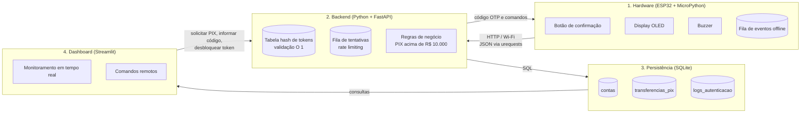
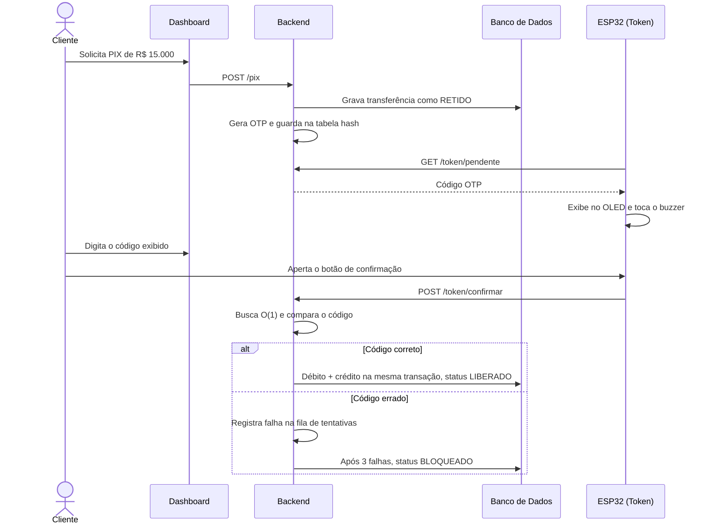

# ByteBank Hardware Key

Token físico de autenticação em duas etapas (MFA) para transferências PIX de alto valor.

Projeto Prático da AV2 da disciplina **BD015 (Algoritmo e Estrutura de Dados)** da CESAR School, ministrada pelo Prof. Fernando Ferreira de Carvalho. A equipe implementa o **Módulo 5 do Ecossistema ByteBank IoT**: um ESP32 programado em MicroPython que funciona como chave física de segurança. Todo PIX acima de R$ 10.000,00 fica retido no banco de dados e só é liberado depois que o titular confirma a operação no token.

## Squad

- João Vitor Souza
- Renan Rocha
- Vinicius Mendes

## Como funciona

1. O cliente solicita um PIX acima de R$ 10.000,00. O backend grava a transferência com status `RETIDO` e gera um código OTP de 6 dígitos com validade de 60 segundos.
2. O ESP32 consulta o backend, exibe o código no display OLED e toca o buzzer.
3. O titular informa o código no dashboard e aperta o botão físico de confirmação no token.
4. O backend valida o código em O(1) na tabela hash de tokens. Se estiver correto, a transferência é liberada e o débito e o crédito são gravados numa única transação no banco.
5. Cada código errado entra na fila de tentativas. Três falhas em cinco minutos bloqueiam a conta e disparam o alarme do token.

## Arquitetura

A solução tem quatro camadas. O ESP32 é sempre quem inicia a conversa com o backend via HTTP: ele envia eventos com `POST` e busca códigos e comandos pendentes com `GET`. Assim o token funciona em qualquer rede, sem precisar de IP fixo na placa.



### Fluxo de uma transferência de alto valor



## Componentes

| Componente | Função |
|---|---|
| ESP32 DevKit | Microcontrolador com Wi-Fi, roda o MicroPython |
| Display OLED SSD1306 (I2C) | Exibe o código OTP e o status da operação |
| Botão (push button) | Confirmação física da transferência |
| Buzzer | Aviso de código novo e alarme de bloqueio |

### Esquema de pinos

| Componente | Pino do componente | Pino do ESP32 |
|---|---|---|
| OLED SSD1306 | VCC / GND | 3V3 / GND |
| OLED SSD1306 | SDA | GPIO 21 |
| OLED SSD1306 | SCL | GPIO 22 |
| Botão | Um terminal / outro terminal | GPIO 15 / GND (pull-up interno: pressionado = 0, solto = 1) |
| Buzzer | Positivo / negativo | GPIO 4 (PWM, define o tom) / GND |
| LED interno | | GPIO 2 (indica status da conexão Wi-Fi) |

O botão e a saída PWM usam os mesmos pinos do guia de configuração da disciplina (GPIO 15 e GPIO 4), então o script de exemplo do guia serve para testar o circuito antes do `main.py`.

## Estrutura do repositório

| Pasta | Conteúdo | Entrega |
|---|---|---|
| `esp32/` | `boot.py` (conexão Wi-Fi) e `main.py` (sensores e atuadores) | 29/10 e 05/11 |
| `backend/` | API em FastAPI com a tabela hash de tokens e a fila de tentativas | 12/11 |
| `database/` | `schema.sql` com as tabelas e a carga inicial de teste | 12/11 |
| `dashboard/` | Aplicação Streamlit de monitoramento e controle remoto | 19/11 |

## Como executar

### 1. Gravar o firmware MicroPython (só na primeira vez)

A placa vem de fábrica sem MicroPython. Baixe o firmware **ESP32_GENERIC** (`.bin`) em [micropython.org/download](https://micropython.org/download/ESP32_GENERIC/), conecte o ESP32 no USB e descubra a porta:

- **macOS:** `ls /dev/cu.*` mostra `/dev/cu.usbserial-XXXX` ou `/dev/cu.wchusbserial-XXXX`. Se nada aparecer, troque o cabo: muitos cabos só carregam e não transmitem dados.
- **Windows:** a porta aparece como `COM3`, `COM5`, etc. no Gerenciador de Dispositivos.

Depois, no terminal, troque `PORTA` pela porta encontrada:

```bash
pip3 install esptool        # no Windows: pip install esptool
esptool --chip esp32 --port PORTA erase_flash
esptool --chip esp32 --port PORTA --baud 115200 write_flash -z --flash_mode dio 0x1000 firmware.bin
```

O `--flash_mode dio` evita que a placa fique reiniciando em loop.

### 2. Configurar a rede

1. Copie `esp32/config_exemplo.py` para `esp32/config.py` e preencha o nome e a senha da rede. O `config.py` fica fora do Git para que a senha não vá para o repositório público.
2. A rede precisa ser **2,4 GHz**: o ESP32 não enxerga redes 5 GHz. No hotspot do iPhone, ative *Ajustes → Acesso Pessoal → Maximizar Compatibilidade*.

### 3. Enviar o código para a placa

**VS Code + MicroPico (recomendado)**

1. Instale a extensão **MicroPico** no VS Code e abra a pasta raiz deste repositório.
2. Rode *MicroPico: Configure Project* na Paleta de Comandos (`Cmd+Shift+P` no Mac, `Ctrl+Shift+P` no Windows) para ativar o autocompletar das bibliotecas `machine` e `network`.
3. Clique em *Pico/ESP32 Connect* na barra inferior e depois em *MicroPico: Upload project to board*.
4. Abra o REPL (*MicroPico: Toggle Execution Terminal / REPL*) e reinicie a placa. O terminal mostra o IP recebido.

O arquivo `.vscode/settings.json` define `micropico.syncFolder` como `esp32`, então o upload envia **só a pasta `esp32/`** para a placa, e não o backend nem o dashboard.

**Thonny (alternativa para testes rápidos)**

1. No canto inferior direito, troque o interpretador para *MicroPython (ESP32)* e selecione a porta.
2. Abra `boot.py` e `config.py` da pasta `esp32/` e salve cada um em *Arquivo → Salvar como → Dispositivo MicroPython*.
3. Reinicie o ESP32. O Shell mostra o IP recebido.

### Teste sem a placa (Wokwi)

1. Crie um projeto em [wokwi.com](https://wokwi.com) com o modelo *MicroPython on ESP32*.
2. Cole o conteúdo de `boot.py` e crie o `config.py` com a rede do simulador: `WIFI_SSID = "Wokwi-GUEST"` e `WIFI_SENHA = ""`.
3. Inicie a simulação. O console mostra a conexão e o IP.
