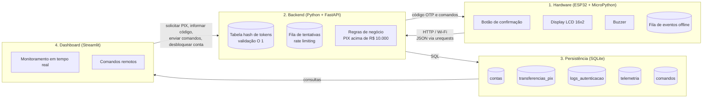
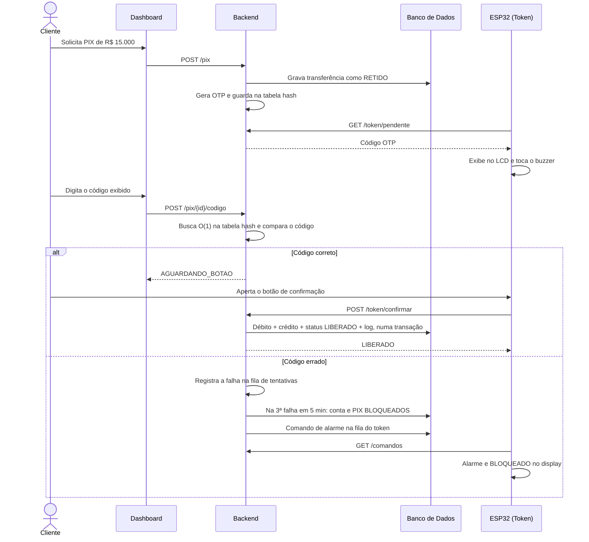
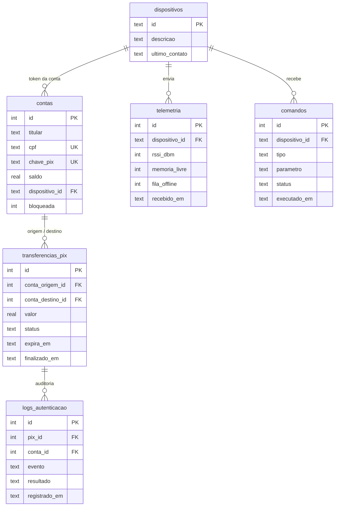

# ByteBank Hardware Key

Token físico de autenticação em duas etapas (MFA) para transferências PIX de alto valor.

Projeto Prático da AV2 da disciplina **BD015 (Algoritmo e Estrutura de Dados)** da CESAR School, ministrada pelo Prof. Fernando Ferreira de Carvalho. A equipe implementa o **Módulo 5 do Ecossistema ByteBank IoT**: um ESP32 programado em MicroPython que funciona como chave física de segurança. Todo PIX acima de R$ 10.000,00 fica retido no banco de dados e só é liberado depois que o titular confirma a operação no token.

## Squad

- João Vitor Souza
- Renan Rocha
- Vinicius Mendes

## Como funciona

1. O cliente solicita um PIX acima de R$ 10.000,00. O backend grava a transferência com status `RETIDO` e gera um código OTP de 6 dígitos com validade de 60 segundos.
2. O ESP32 consulta o backend, exibe o código no display LCD e toca o buzzer.
3. O titular digita no dashboard o código que aparece no display. O backend valida em O(1) na tabela hash de tokens.
4. Com o código aceito, o titular aperta o botão físico do token. Só então a transferência é liberada, e o débito, o crédito, o status e o log de auditoria são gravados numa única transação no banco.
5. Cada código errado entra na fila de tentativas. Três falhas em cinco minutos bloqueiam a conta e disparam o alarme do token.
6. O dashboard mostra a telemetria do token em tempo real e envia comandos para o ESP32: acionar o alarme, exibir uma mensagem no display e reiniciar a placa.

Os dois fatores são complementares: o código prova que o cliente está vendo o token, e o botão prova que ele está com o token na mão e quer a transferência.

## Arquitetura

A solução tem quatro camadas. O ESP32 é sempre quem inicia a conversa com o backend via HTTP: ele envia eventos com `POST` e busca códigos e comandos pendentes com `GET`. Assim o token funciona em qualquer rede, sem precisar de IP fixo na placa.



### Fluxo de uma transferência de alto valor



## Componentes

| Componente | Função |
|---|---|
| ESP32 DevKit | Microcontrolador com Wi-Fi, roda o MicroPython |
| Display LCD 16x2 com adaptador I2C (PCF8574, endereço `0x27`) | Exibe o código OTP e o status da operação |
| Botão (push button) | Confirmação física da transferência |
| Buzzer ativo | Aviso de código novo e alarme de bloqueio |

### Esquema de pinos

| Componente | Pino do componente | Pino do ESP32 |
|---|---|---|
| Display LCD (adaptador I2C) | VCC / GND | VIN (5 V) / GND |
| Display LCD (adaptador I2C) | SDA | GPIO 22 |
| Display LCD (adaptador I2C) | SCL | GPIO 21 |
| Botão | Um terminal / terminal diagonal | GPIO 15 / 3V3 (pull-down interno: pressionado = 1, solto = 0) |
| Buzzer ativo | Positivo (perna longa) / negativo | GPIO 4 / GND |
| LED interno | | GPIO 2 (indica status da conexão Wi-Fi) |

O botão e o buzzer usam os mesmos pinos do guia de configuração da disciplina (GPIO 15 e GPIO 4), então o script de exemplo do guia serve para testar o circuito antes do `main.py`.

Observações da montagem na bancada:

- **O LCD precisa de 5 V.** Com 3,3 V a luz de fundo acende, mas as letras não aparecem. Se mesmo no VIN as letras não surgirem, ajuste o contraste no potenciômetro azul do adaptador I2C.
- **No adaptador I2C a ordem dos pinos é GND, VCC, SDA, SCL.** Os fios foram ligados com SDA no GPIO 22 e SCL no GPIO 21, e o código usa essa ordem. O endereço `0x27` e os pinos foram confirmados com `i2c.scan()`.
- **O buzzer é ativo:** tem oscilador interno e apita só de receber tensão, então o código apenas liga e desliga o pino. Ele tem polaridade: invertido, fica mudo.
- **O ESP32 da equipe tem só 2 pinos GND**, um para o display e outro para o buzzer. Por isso o botão liga o GPIO 15 ao **3V3** (livre desde que o display passou para o VIN), e o código usa o pull-down interno: o pino fica em 0 com o botão solto e vai a 1 quando ele é apertado.
- O buzzer está ligado direto nos pinos do ESP32, sem passar pela protoboard.
- Os jumpers são macho-fêmea: a ponta fêmea vai no pino do ESP32 e a macho na protoboard, por isso o ESP32 fica fora da protoboard.

## Estrutura do repositório

| Pasta | Conteúdo | Entrega |
|---|---|---|
| `esp32/` | `boot.py` (conexão Wi-Fi), `main.py` (botão, display, buzzer e envio HTTP), `fila_offline.py` (fila circular) e `lcd_i2c.py` (driver do display LCD) | 29/10 e 05/11 |
| `backend/` | `app.py` (API em FastAPI), `estruturas.py` (tabela hash de tokens e fila de tentativas) e `db.py` (conexão e transações). `servidor_teste.py` é o servidor simplificado usado na Entrega 2 | 05/11 e 12/11 |
| `database/` | `schema.sql` (modelo relacional) e `seed.sql` (carga inicial de teste). O banco `bytebank.db` é criado pela API e fica fora do Git | 12/11 |
| `dashboard/` | `app.py`: aplicação Streamlit de monitoramento e controle remoto | 19/11 |
| `tests/` | Testes automatizados da fila do ESP32 e da API, que rodam no computador sem a placa | 05/11 e 19/11 |
| `wokwi/` | `diagram.json` com o circuito completo para o simulador Wokwi | 05/11 |
| `docs/` | Imagens e evidências de teste usadas neste README | — |

## Como executar

### 1. Gravar o firmware MicroPython (só na primeira vez)

A placa vem de fábrica sem MicroPython. Baixe o firmware **ESP32_GENERIC** (`.bin`) em [micropython.org/download](https://micropython.org/download/ESP32_GENERIC/), conecte o ESP32 no USB e descubra a porta:

- **macOS:** `ls /dev/cu.*` mostra `/dev/cu.usbserial-XXXX` ou `/dev/cu.wchusbserial-XXXX`. Se nada aparecer, troque o cabo: muitos cabos só carregam e não transmitem dados.
- **Windows:** a porta aparece como `COM3`, `COM5`, etc. no Gerenciador de Dispositivos.

Depois, no terminal, troque `PORTA` pela porta encontrada:

```bash
pip3 install esptool        # no Windows: pip install esptool
esptool --chip esp32 --port PORTA erase_flash
esptool --chip esp32 --port PORTA --baud 115200 write_flash -z --flash_mode dio 0x1000 firmware.bin
```

O `--flash_mode dio` evita que a placa fique reiniciando em loop.

### 2. Configurar a rede

1. Copie `esp32/config_exemplo.py` para `esp32/config.py` e preencha o nome e a senha da rede. O `config.py` fica fora do Git para que a senha não vá para o repositório público.
2. A rede precisa ser **2,4 GHz**: o ESP32 não enxerga redes 5 GHz. No hotspot do iPhone, ative *Ajustes → Acesso Pessoal → Maximizar Compatibilidade*.

### 3. Enviar o código para a placa

**VS Code + MicroPico (recomendado)**

1. Instale a extensão **MicroPico** no VS Code e abra a pasta raiz deste repositório.
2. Rode *MicroPico: Configure Project* na Paleta de Comandos (`Cmd+Shift+P` no Mac, `Ctrl+Shift+P` no Windows) para ativar o autocompletar das bibliotecas `machine` e `network`.
3. Clique em *Pico/ESP32 Connect* na barra inferior e depois em *MicroPico: Upload project to board*.
4. Abra o REPL (*MicroPico: Toggle Execution Terminal / REPL*) e reinicie a placa. O terminal mostra o IP recebido.

O arquivo `.vscode/settings.json` define `micropico.syncFolder` como `esp32`, então o upload envia **só a pasta `esp32/`** para a placa, e não o backend nem o dashboard.

**Thonny (alternativa para testes rápidos)**

1. No canto inferior direito, troque o interpretador para *MicroPython (ESP32)* e selecione a porta.
2. Abra cada arquivo da pasta `esp32/` (`boot.py`, `config.py`, `main.py`, `fila_offline.py` e `lcd_i2c.py`) e salve em *Arquivo → Salvar como → Dispositivo MicroPython*, com o mesmo nome.
3. Reinicie o ESP32. O Shell mostra o IP recebido e as mensagens do token.

### 4. Instalar as dependências do computador

A API, o dashboard e os testes rodam no Python 3.9 ou mais novo:

```bash
python3 -m venv .venv
.venv/bin/pip install -r requirements.txt
```

No Windows, use `.venv\Scripts\pip` e `.venv\Scripts\uvicorn` no lugar de `.venv/bin/...`.

### 5. Subir a API e o dashboard

Em dois terminais, na raiz do repositório:

```bash
.venv/bin/uvicorn backend.app:app --host 0.0.0.0 --port 8000
```

```bash
.venv/bin/streamlit run dashboard/app.py
```

- Na primeira execução, a API cria o banco `database/bytebank.db` a partir do `schema.sql` e do `seed.sql`. Para voltar ao estado inicial, basta apagar esse arquivo.
- A documentação interativa da API fica em `http://localhost:8000/docs`.
- O dashboard abre em `http://localhost:8501`.
- O `--host 0.0.0.0` é obrigatório: sem ele, a API só aceita conexões do próprio computador, e o ESP32 fica de fora.

### 6. Fluxo completo do PIX pelo dashboard

1. Com o ESP32 ligado na mesma rede do computador, o cartão **Token** no topo do dashboard fica 🟢 Online, e a aba **Telemetria** passa a desenhar os gráficos.
2. Na aba **PIX**, envie um PIX da Ana para o Bruno acima de R$ 10.000. Ele aparece em *PIX aguardando o token*.
3. O token apita e mostra o código no display. Digite o código no dashboard e clique em **Validar código**.
4. Aperte o botão do token. O display mostra `PIX LIBERADO`, e os saldos mudam na aba **Auditoria**.
5. Na aba **Comandos para o ESP32**, acione o alarme, envie uma mensagem ou reinicie a placa.

### Servidor de teste simplificado (Entrega 2)

O `servidor_teste.py` simulou o backend antes da API real ficar pronta. Ele usa só a biblioteca padrão do Python e continua no repositório como registro da Entrega 2.

1. Descubra o IP do computador na rede do ESP32 e coloque em `SERVIDOR_URL` no `config.py` (ex: `http://192.168.0.10:8000`). Nunca use `localhost`: para o ESP32, `localhost` é ele mesmo.
   - **macOS:** `ipconfig getifaddr en0`
   - **Windows:** `ipconfig` (campo *Endereço IPv4*)
2. Inicie o servidor na raiz do repositório:
   ```bash
   python3 backend/servidor_teste.py
   ```
   No macOS, permita quando o sistema perguntar se o Python pode aceitar conexões de entrada. Se negar, o ESP32 não consegue se conectar ao servidor.
3. Abra `http://localhost:8000/teste/novo-pix` no navegador. O terminal do servidor mostra o PIX retido e o código gerado.
4. Em até 2 segundos o token apita, e o display mostra o valor e o destinatário na linha de cima (`R$15.000 Bruno`) e o código com a contagem regressiva de 60 segundos na de baixo (`Cod 583921 45s`).
5. Aperte o botão. O terminal do servidor mostra o JSON recebido e o resultado `LIBERADO`, e o display mostra `PIX LIBERADO`.

Para testar a fila offline, desligue o hotspot depois do passo 4, aperte o botão e religue. O display mostra `SEM CONEXAO / Guardado fila:1`, e o envio acontece sozinho quando a rede volta.

### Teste sem a placa (Wokwi)

1. Crie um projeto em [wokwi.com](https://wokwi.com) com o modelo *MicroPython on ESP32*.
2. Abra a aba `diagram.json` do projeto e copie o valor de `"env"` que aparece em `attrs` da placa (é a versão do MicroPython do simulador). Substitua o conteúdo da aba pelo `wokwi/diagram.json` deste repositório e cole o `"env"` de volta em `attrs` da placa `esp`. O circuito aparece com display LCD, botão e buzzer ligados.
3. Crie os arquivos `boot.py`, `main.py`, `fila_offline.py` e `lcd_i2c.py` com o conteúdo da pasta `esp32/`, e um `config.py` com a rede do simulador: `WIFI_SSID = "Wokwi-GUEST"` e `WIFI_SENHA = ""`.
4. Inicie a simulação.

O simulador roda nos servidores do Wokwi e não alcança o `servidor_teste.py` no seu computador. Sem um endereço público, o token fica sem servidor: as confirmações vão para a fila offline, e o display mostra a quantidade guardada. Para testar o fluxo completo no Wokwi, exponha o servidor com um túnel (ex: `cloudflared tunnel --url http://localhost:8000`) e use o endereço `https://...` gerado como `SERVIDOR_URL`.

## Estruturas de dados no ESP32

### Fila offline (fila circular)

Toda confirmação do botão entra em uma fila antes de ser enviada, com ou sem rede. O envio pega o evento mais antigo (`primeiro()`) e só o remove (`desenfileirar()`) depois que o servidor responde. Se o Wi-Fi cair no meio do envio, o evento continua na fila e é reenviado quando a conexão volta, na ordem em que os cliques aconteceram (FIFO).

A fila é **circular** (ring buffer) com capacidade fixa de 20 eventos:

- **Memória previsível:** o vetor é alocado uma única vez e nunca cresce. Isso importa no ESP32, que tem pouca RAM.
- **O(1) nas duas pontas:** remover do início de uma lista comum (`pop(0)`) desloca todos os itens, O(n). Na fila circular só o índice do início avança.
- **Fila cheia descarta o mais antigo:** uma confirmação antiga já estaria expirada no servidor, porque o código vale 60 segundos. O total descartado é enviado na telemetria.

O ESP32 não tem relógio sincronizado. Por isso cada evento guarda o instante do clique em `ticks_ms()`, e o pacote leva a idade do evento (`idade_ms`). O servidor calcula o horário real do clique subtraindo a idade da hora de chegada. Assim vale o momento do clique, e não o da chegada: um clique feito dentro dos 60 segundos que ficou preso na fila ainda é aceito, e um clique feito fora do prazo é recusado.

A telemetria (sinal do Wi-Fi, memória livre, tamanho da fila) **não** entra na fila: é descartável e não pode ocupar o lugar de uma confirmação.

### Pacotes JSON enviados

| Rota | Quando | Exemplo |
|---|---|---|
| `GET /token/pendente` | A cada 2 s, enquanto não há código na tela | Resposta: `{"pendente": {"pix_id": 1, "otp": "583921", "valor": 15000.0, "destino": "Bruno", "expira_em_s": 60}}` |
| `POST /token/confirmar` | Ao apertar o botão (via fila) | `{"dispositivo": "token-01", "pix_id": 1, "idade_ms": 149}` |
| `POST /telemetria` | A cada 30 s | `{"dispositivo": "token-01", "rssi_dbm": -55, "memoria_livre": 98304, "fila_offline": 0, "eventos_descartados": 0, "ligado_ha_s": 31}` |

## Backend e banco de dados

### Rotas da API

| Rota | Quem chama | O que faz |
|---|---|---|
| `POST /pix` | Dashboard | Até R$ 10.000 transfere na hora (`CONCLUIDO`). Acima disso grava `RETIDO` e gera o código na tabela hash. O código não volta na resposta: só aparece no token |
| `GET /token/pendente?dispositivo=` | ESP32 | Devolve o PIX retido mais antigo daquele token, com o código e os segundos restantes |
| `POST /pix/{id}/codigo` | Dashboard | Valida o código digitado. Responde `AGUARDANDO_BOTAO`, `CODIGO_INCORRETO` (com as tentativas restantes), `BLOQUEADO` ou `EXPIRADO` |
| `POST /token/confirmar` | ESP32 | Botão apertado. Com o código já validado, libera o PIX numa transação. Sem o código, responde `AGUARDANDO_CODIGO` |
| `POST /telemetria` | ESP32 | Grava uma leitura de sinal, memória e fila offline (a cada 10 s) |
| `GET /comandos?dispositivo=` | ESP32 | Lista os comandos pendentes, do mais antigo para o mais novo |
| `POST /comandos/{id}/executado` | ESP32 | Marca o comando como executado |
| `POST /comandos` | Dashboard | Cria um comando: `ALARME`, `MENSAGEM` ou `REINICIAR` |
| `POST /contas/{id}/desbloquear` | Dashboard | Desbloqueio pelo gerente: zera a fila de tentativas e avisa o token |

O FastAPI valida cada JSON antes de chegar na regra de negócio: valor negativo, código que não tem 6 dígitos ou tipo de comando desconhecido voltam com erro `422`.

### Estruturas de dados no backend

- **Tabela hash de tokens** (`TabelaTokens`, em `estruturas.py`): dicionário `pix_id → código`. A validação do código digitado vai direto na posição da chave, em O(1), sem percorrer os outros PIX pendentes. Uma segunda tabela hash, `dispositivo → fila de PIX`, entrega ao ESP32 o pendente mais antigo. O código é gerado com `secrets` (gerador criptográfico) e comparado com `hmac.compare_digest`, em tempo constante.
- **Fila de tentativas** (`FilaTentativas`): para cada conta, uma `deque` com o horário de cada código errado. Antes de contar, as falhas com mais de 5 minutos saem pela frente da fila (janela deslizante, `popleft` em O(1)). Na 3ª falha dentro da janela, a conta é bloqueada.
- **Tabela hash de chaves PIX**: `chave → conta`, carregada quando a API sobe. Achar o destino de um PIX é O(1).

Os códigos ficam **só na memória** da API, nunca no banco: quem copiar o arquivo do banco não leva nenhum código válido. Em contrapartida, se a API reiniciar, os PIX retidos perdem o código, e por isso ela os marca como `EXPIRADO` ao subir.

### Atualização atômica

O débito, o crédito, a mudança de status e o log de auditoria acontecem dentro de uma única transação (`BEGIN IMMEDIATE ... COMMIT`, em `db.transacao`). Se qualquer passo falhar, nada é gravado. O débito usa `UPDATE contas SET saldo = saldo - ? WHERE id = ? AND saldo >= ?`: o saldo é conferido no mesmo comando que debita, então um PIX que esperou o token enquanto outro gastava o dinheiro é recusado (`RECUSADO`) em vez de deixar a conta negativa. O banco também protege isso com `CHECK (saldo >= 0)`.

### Modelo relacional



Status de uma transferência: `CONCLUIDO` (até R$ 10.000), `RETIDO` (aguardando o token), `LIBERADO`, `EXPIRADO`, `BLOQUEADO` e `RECUSADO` (saldo insuficiente na hora da liberação).

## Dashboard

O dashboard lê o banco direto, em modo somente leitura, e se atualiza sozinho a cada 2 segundos (`st.fragment(run_every="2s")`). Toda ação passa pela API, que é quem aplica as regras de negócio.

| Aba | Conteúdo |
|---|---|
| Topo | Token online ou offline (último contato há menos de 30 s), sinal Wi-Fi, memória livre, fila offline e tempo ligado |
| Telemetria | Gráficos do sinal, da memória e da fila offline ao longo das últimas leituras |
| PIX | Solicitar PIX, digitar o código do token e acompanhar as últimas transferências |
| Comandos para o ESP32 | Acionar alarme, mensagem no display (até 32 caracteres; os acentos são removidos porque o LCD não tem), reiniciar a placa, desbloquear conta e histórico dos comandos |
| Auditoria | Saldos das contas e log de autenticação |

### Como o comando chega ao ESP32

O ESP32 não recebe conexões: a cada 2 segundos ele pergunta à API se há comandos na fila (`GET /comandos`). O comando é confirmado (`POST /comandos/{id}/executado`) **antes** de ser executado. Se fosse depois, um `REINICIAR` nunca seria confirmado, voltaria na próxima consulta e reiniciaria a placa em loop. Se a confirmação falhar por causa da rede, o token não executa e tenta de novo no ciclo seguinte.

A própria API também usa essa fila para falar com o token: quando a conta é bloqueada, ela coloca um `RESULTADO BLOQUEADO`, e o token toca o alarme mesmo estando no meio da contagem do código. No desbloqueio, coloca um `DESBLOQUEADO`.

## Testes

### Testes automatizados da fila

A fila não depende de hardware, então os testes rodam no computador:

```bash
python3 -m unittest discover tests
```

Eles conferem a ordem FIFO, a consulta sem remoção, o descarte do mais antigo com a fila cheia e a volta dos índices no vetor circular.

### Testes automatizados da API

O mesmo comando roda também os 14 testes de `tests/test_api.py`. Cada teste faz o papel do dashboard e do ESP32, chamando as mesmas rotas que eles chamam, num banco temporário. O relógio da API é substituído, então a expiração de 60 segundos e a janela de 5 minutos são testadas sem esperar. Os testes cobrem:

- PIX até o limite transferido na hora e validações do pedido (chave inexistente, mesma conta, saldo insuficiente, valor negativo, conta sem token);
- fluxo completo: código no dashboard, botão no token, saldos atualizados;
- botão antes do código não libera, e o token continua mostrando o mesmo código;
- reenvio da mesma confirmação pela fila offline não debita duas vezes;
- expiração do código e clique dentro do prazo que chegou atrasado pela fila offline;
- bloqueio na 3ª falha, com o alarme enviado ao token, e falhas antigas saindo da janela deslizante;
- desbloqueio pelo gerente, telemetria, comandos e PIX retido que expira quando a API reinicia.

### Circuito montado na bancada

ESP32 conectado ao hotspot (LED azul aceso), display LCD 16x2 na tela inicial do token, botão de confirmação na protoboard e jumpers macho-fêmea ligando cada componente aos pinos do ESP32.


### Fluxo completo na bancada (05/11)

Com o ESP32 conectado ao hotspot do celular e o `servidor_teste.py` rodando no notebook, um PIX de teste foi criado, o token exibiu o código no display, e o botão foi apertado. Registro do servidor:

```text
[21:32:01] POST /telemetria <- {"rssi_dbm": -36, "fila_offline": 0, "memoria_livre": 115728, "ligado_ha_s": 120, "dispositivo": "token-01", "eventos_descartados": 0}
[21:32:02] PIX 3 RETIDO | R$ 15000.00 | código 953094
[21:32:03] Token token-01 buscou o PIX 3
[21:32:14] POST /token/confirmar <- {"idade_ms": 142, "dispositivo": "token-01", "pix_id": 3}
[21:32:14] PIX 3 LIBERADO | botão apertado às 21:32:14 (há 0.1s)
```

Problemas encontrados na montagem e como foram resolvidos:

| Sintoma | Causa | Solução |
|---|---|---|
| Display com luz acesa e sem letras | LCD alimentado com 3,3 V | VCC no VIN (5 V) |
| Display respondendo com SDA e SCL invertidos | Ordem dos pinos do adaptador I2C (GND, VCC, SDA, SCL) | Código passou a usar SDA no GPIO 22 e SCL no GPIO 21 |
| Buzzer mudo | Buzzer ativo com a perna + fora da coluna do jumper do GPIO 4 | Buzzer ligado direto no GPIO 4 e no GND |
| Botão nunca detectado | Sem pino GND livre para o botão | Botão ligado ao 3V3 com pull-down interno |
| ESP32 não encontra o hotspot do iPhone | Hotspot em 5 GHz | *Maximizar Compatibilidade* ativado (2,4 GHz) e tela do Acesso Pessoal aberta durante a conexão |
| Linha de baixo do display com caracteres embaralhados | Uma metade de 4 bits perdida na transmissão (ruído do Wi-Fi ou dos jumpers) desalinha o LCD | I2C reduzido para 50 kHz e `sincronizar()` antes de cada troca de tela |
| `Wifi Internal State Error` ao reiniciar a placa | Tentativa de conexão anterior pela metade | `boot.py` e `main.py` chamam `disconnect()` antes de `connect()` |

### Conexão Wi-Fi no simulador (22/10)

O `boot.py` foi executado no Wokwi com a rede `Wokwi-GUEST`. A placa conectou na primeira tentativa e recebeu o IP `10.10.0.2`. Na sequência, o MicroPython executou o `main.py`, o que confirma a ordem de inicialização: primeiro a rede, depois a aplicação.


