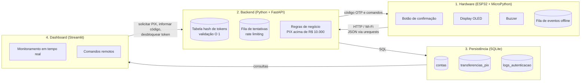
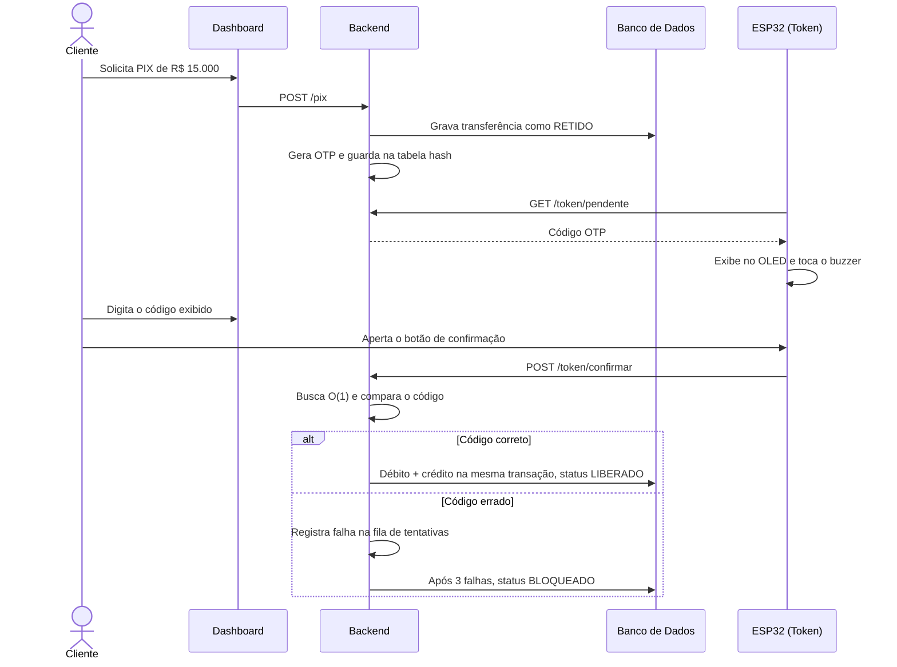
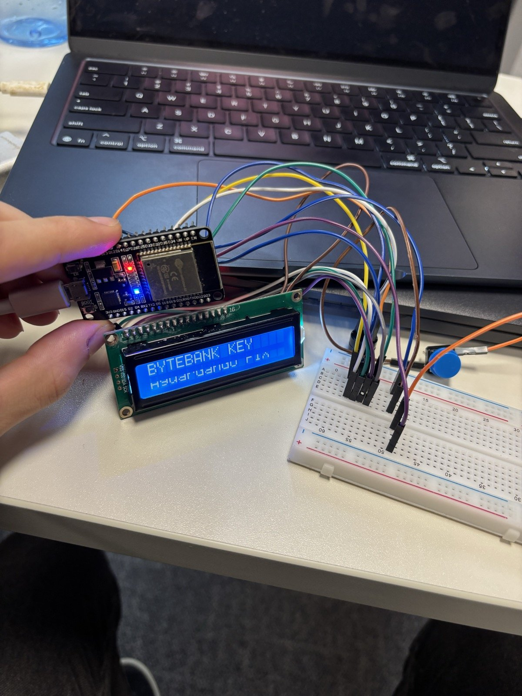
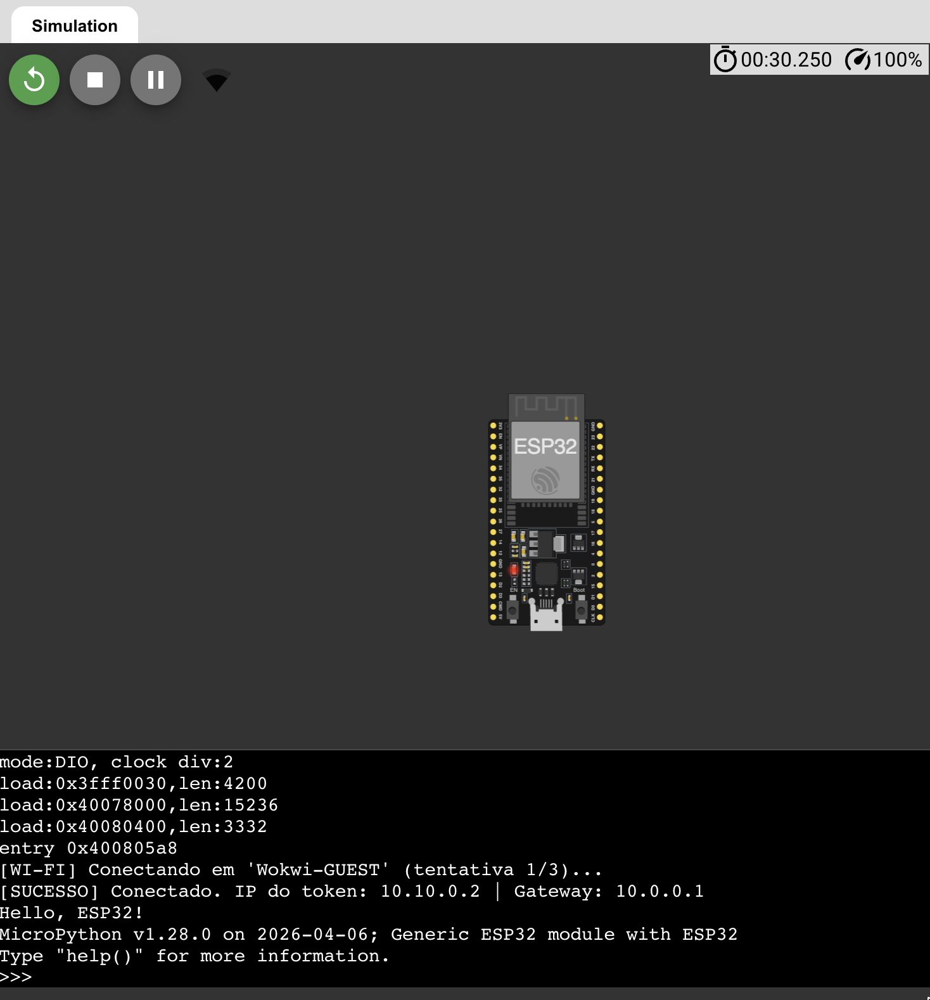

# ByteBank Hardware Key

Token físico de autenticação em duas etapas (MFA) para transferências PIX de alto valor.

Projeto Prático da AV2 da disciplina **BD015 (Algoritmo e Estrutura de Dados)** da CESAR School, ministrada pelo Prof. Fernando Ferreira de Carvalho. A equipe implementa o **Módulo 5 do Ecossistema ByteBank IoT**: um ESP32 programado em MicroPython que funciona como chave física de segurança. Todo PIX acima de R$ 10.000,00 fica retido no banco de dados e só é liberado depois que o titular confirma a operação no token.

## Squad

- João Vitor Souza
- Renan Rocha
- Vinicius Mendes

## Como funciona

1. O cliente solicita um PIX acima de R$ 10.000,00. O backend grava a transferência com status `RETIDO` e gera um código OTP de 6 dígitos com validade de 60 segundos.
2. O ESP32 consulta o backend, exibe o código no display OLED e toca o buzzer.
3. O titular informa o código no dashboard e aperta o botão físico de confirmação no token.
4. O backend valida o código em O(1) na tabela hash de tokens. Se estiver correto, a transferência é liberada e o débito e o crédito são gravados numa única transação no banco.
5. Cada código errado entra na fila de tentativas. Três falhas em cinco minutos bloqueiam a conta e disparam o alarme do token.

## Arquitetura

A solução tem quatro camadas. O ESP32 é sempre quem inicia a conversa com o backend via HTTP: ele envia eventos com `POST` e busca códigos e comandos pendentes com `GET`. Assim o token funciona em qualquer rede, sem precisar de IP fixo na placa.



### Fluxo de uma transferência de alto valor



## Componentes

| Componente | Função |
|---|---|
| ESP32 DevKit | Microcontrolador com Wi-Fi, roda o MicroPython |
| Display OLED SSD1306 (I2C) | Exibe o código OTP e o status da operação |
| Botão (push button) | Confirmação física da transferência |
| Buzzer | Aviso de código novo e alarme de bloqueio |

### Esquema de pinos

| Componente | Pino do componente | Pino do ESP32 |
|---|---|---|
| OLED SSD1306 | VCC / GND | 3V3 / GND |
| OLED SSD1306 | SDA | GPIO 21 |
| OLED SSD1306 | SCL | GPIO 22 |
| Botão | Um terminal / outro terminal | GPIO 15 / GND (pull-up interno: pressionado = 0, solto = 1) |
| Buzzer | Positivo / negativo | GPIO 4 (PWM, define o tom) / GND |
| LED interno | | GPIO 2 (indica status da conexão Wi-Fi) |

O botão e a saída PWM usam os mesmos pinos do guia de configuração da disciplina (GPIO 15 e GPIO 4), então o script de exemplo do guia serve para testar o circuito antes do `main.py`.

## Estrutura do repositório

| Pasta | Conteúdo | Entrega |
|---|---|---|
| `esp32/` | `boot.py` (conexão Wi-Fi), `main.py` (botão, OLED, buzzer e envio HTTP), `fila_offline.py` (fila circular) e `ssd1306.py` (driver do display) | 29/10 e 05/11 |
| `backend/` | `servidor_teste.py` (simula o backend para validar o ESP32). Depois: API em FastAPI com a tabela hash de tokens e a fila de tentativas | 05/11 e 12/11 |
| `database/` | `schema.sql` com as tabelas e a carga inicial de teste | 12/11 |
| `dashboard/` | Aplicação Streamlit de monitoramento e controle remoto | 19/11 |
| `tests/` | Testes automatizados que rodam no computador, sem a placa | 05/11 |
| `wokwi/` | `diagram.json` com o circuito completo para o simulador Wokwi | 05/11 |
| `docs/` | Imagens e evidências de teste usadas neste README | — |

## Como executar

### 1. Gravar o firmware MicroPython (só na primeira vez)

A placa vem de fábrica sem MicroPython. Baixe o firmware **ESP32_GENERIC** (`.bin`) em [micropython.org/download](https://micropython.org/download/ESP32_GENERIC/), conecte o ESP32 no USB e descubra a porta:

- **macOS:** `ls /dev/cu.*` mostra `/dev/cu.usbserial-XXXX` ou `/dev/cu.wchusbserial-XXXX`. Se nada aparecer, troque o cabo: muitos cabos só carregam e não transmitem dados.
- **Windows:** a porta aparece como `COM3`, `COM5`, etc. no Gerenciador de Dispositivos.

Depois, no terminal, troque `PORTA` pela porta encontrada:

```bash
pip3 install esptool        # no Windows: pip install esptool
esptool --chip esp32 --port PORTA erase_flash
esptool --chip esp32 --port PORTA --baud 115200 write_flash -z --flash_mode dio 0x1000 firmware.bin
```

O `--flash_mode dio` evita que a placa fique reiniciando em loop.

### 2. Configurar a rede

1. Copie `esp32/config_exemplo.py` para `esp32/config.py` e preencha o nome e a senha da rede. O `config.py` fica fora do Git para que a senha não vá para o repositório público.
2. A rede precisa ser **2,4 GHz**: o ESP32 não enxerga redes 5 GHz. No hotspot do iPhone, ative *Ajustes → Acesso Pessoal → Maximizar Compatibilidade*.

### 3. Enviar o código para a placa

**VS Code + MicroPico (recomendado)**

1. Instale a extensão **MicroPico** no VS Code e abra a pasta raiz deste repositório.
2. Rode *MicroPico: Configure Project* na Paleta de Comandos (`Cmd+Shift+P` no Mac, `Ctrl+Shift+P` no Windows) para ativar o autocompletar das bibliotecas `machine` e `network`.
3. Clique em *Pico/ESP32 Connect* na barra inferior e depois em *MicroPico: Upload project to board*.
4. Abra o REPL (*MicroPico: Toggle Execution Terminal / REPL*) e reinicie a placa. O terminal mostra o IP recebido.

O arquivo `.vscode/settings.json` define `micropico.syncFolder` como `esp32`, então o upload envia **só a pasta `esp32/`** para a placa, e não o backend nem o dashboard.

**Thonny (alternativa para testes rápidos)**

1. No canto inferior direito, troque o interpretador para *MicroPython (ESP32)* e selecione a porta.
2. Abra cada arquivo da pasta `esp32/` (`boot.py`, `config.py`, `main.py`, `fila_offline.py` e `ssd1306.py`) e salve em *Arquivo → Salvar como → Dispositivo MicroPython*, com o mesmo nome.
3. Reinicie o ESP32. O Shell mostra o IP recebido e as mensagens do token.

### 4. Rodar o servidor de teste e confirmar um PIX

O `servidor_teste.py` simula o backend até a API real ficar pronta. Ele usa só a biblioteca padrão do Python, então não precisa instalar nada.

1. Descubra o IP do computador na rede do ESP32 e coloque em `SERVIDOR_URL` no `config.py` (ex: `http://192.168.0.10:8000`). Nunca use `localhost`: para o ESP32, `localhost` é ele mesmo.
   - **macOS:** `ipconfig getifaddr en0`
   - **Windows:** `ipconfig` (campo *Endereço IPv4*)
2. Inicie o servidor na raiz do repositório:
   ```bash
   python3 backend/servidor_teste.py
   ```
   No macOS, permita quando o sistema perguntar se o Python pode aceitar conexões de entrada. Se negar, o ESP32 não consegue se conectar ao servidor.
3. Abra `http://localhost:8000/teste/novo-pix` no navegador. O terminal do servidor mostra o PIX retido e o código gerado.
4. Em até 2 segundos o token apita, e o OLED mostra o valor, o destinatário, o código e a contagem regressiva de 60 segundos.
5. Aperte o botão. O terminal do servidor mostra o JSON recebido e o resultado `LIBERADO`, e o OLED confirma.

Para testar a fila offline, desligue o hotspot depois do passo 4, aperte o botão e religue. O OLED mostra `Confirmacao guardada na fila`, e o envio acontece sozinho quando a rede volta.

### Teste sem a placa (Wokwi)

1. Crie um projeto em [wokwi.com](https://wokwi.com) com o modelo *MicroPython on ESP32*.
2. Abra a aba `diagram.json` do projeto e copie o valor de `"env"` que aparece em `attrs` da placa (é a versão do MicroPython do simulador). Substitua o conteúdo da aba pelo `wokwi/diagram.json` deste repositório e cole o `"env"` de volta em `attrs` da placa `esp`. O circuito aparece com OLED, botão e buzzer ligados.
3. Crie os arquivos `boot.py`, `main.py`, `fila_offline.py` e `ssd1306.py` com o conteúdo da pasta `esp32/`, e um `config.py` com a rede do simulador: `WIFI_SSID = "Wokwi-GUEST"` e `WIFI_SENHA = ""`.
4. Inicie a simulação.

O simulador roda nos servidores do Wokwi e não alcança o `servidor_teste.py` no seu computador. Sem um endereço público, o token fica sem servidor: as confirmações vão para a fila offline, e o OLED mostra a quantidade guardada. Para testar o fluxo completo no Wokwi, exponha o servidor com um túnel (ex: `cloudflared tunnel --url http://localhost:8000`) e use o endereço `https://...` gerado como `SERVIDOR_URL`.

## Estruturas de dados no ESP32

### Fila offline (fila circular)

Toda confirmação do botão entra em uma fila antes de ser enviada, com ou sem rede. O envio pega o evento mais antigo (`primeiro()`) e só o remove (`desenfileirar()`) depois que o servidor responde. Se o Wi-Fi cair no meio do envio, o evento continua na fila e é reenviado quando a conexão volta, na ordem em que os cliques aconteceram (FIFO).

A fila é **circular** (ring buffer) com capacidade fixa de 20 eventos:

- **Memória previsível:** o vetor é alocado uma única vez e nunca cresce. Isso importa no ESP32, que tem pouca RAM.
- **O(1) nas duas pontas:** remover do início de uma lista comum (`pop(0)`) desloca todos os itens, O(n). Na fila circular só o índice do início avança.
- **Fila cheia descarta o mais antigo:** uma confirmação antiga já estaria expirada no servidor, porque o código vale 60 segundos. O total descartado é enviado na telemetria.

O ESP32 não tem relógio sincronizado. Por isso cada evento guarda o instante do clique em `ticks_ms()`, e o pacote leva a idade do evento (`idade_ms`). O servidor calcula o horário real do clique subtraindo a idade da hora de chegada. Assim vale o momento do clique, e não o da chegada: um clique feito dentro dos 60 segundos que ficou preso na fila ainda é aceito, e um clique feito fora do prazo é recusado.

A telemetria (sinal do Wi-Fi, memória livre, tamanho da fila) **não** entra na fila: é descartável e não pode ocupar o lugar de uma confirmação.

### Pacotes JSON enviados

| Rota | Quando | Exemplo |
|---|---|---|
| `GET /token/pendente` | A cada 2 s, enquanto não há código na tela | Resposta: `{"pendente": {"pix_id": 1, "otp": "583921", "valor": 15000.0, "destino": "Bruno", "expira_em_s": 60}}` |
| `POST /token/confirmar` | Ao apertar o botão (via fila) | `{"dispositivo": "token-01", "pix_id": 1, "idade_ms": 149}` |
| `POST /telemetria` | A cada 30 s | `{"dispositivo": "token-01", "rssi_dbm": -55, "memoria_livre": 98304, "fila_offline": 0, "eventos_descartados": 0, "ligado_ha_s": 31}` |

## Testes

### Testes automatizados da fila

A fila não depende de hardware, então os testes rodam no computador:

```bash
python3 -m unittest discover tests
```

Eles conferem a ordem FIFO, a consulta sem remoção, o descarte do mais antigo com a fila cheia e a volta dos índices no vetor circular.

<!-- ENTREGA 2: INSERIR AQUI A FOTO OU GIF DO CIRCUITO MONTADO NA BANCADA
### Circuito montado na bancada


-->

### Conexão Wi-Fi no simulador (22/10)

O `boot.py` foi executado no Wokwi com a rede `Wokwi-GUEST`. A placa conectou na primeira tentativa e recebeu o IP `10.10.0.2`. Na sequência, o MicroPython executou o `main.py`, o que confirma a ordem de inicialização: primeiro a rede, depois a aplicação.


